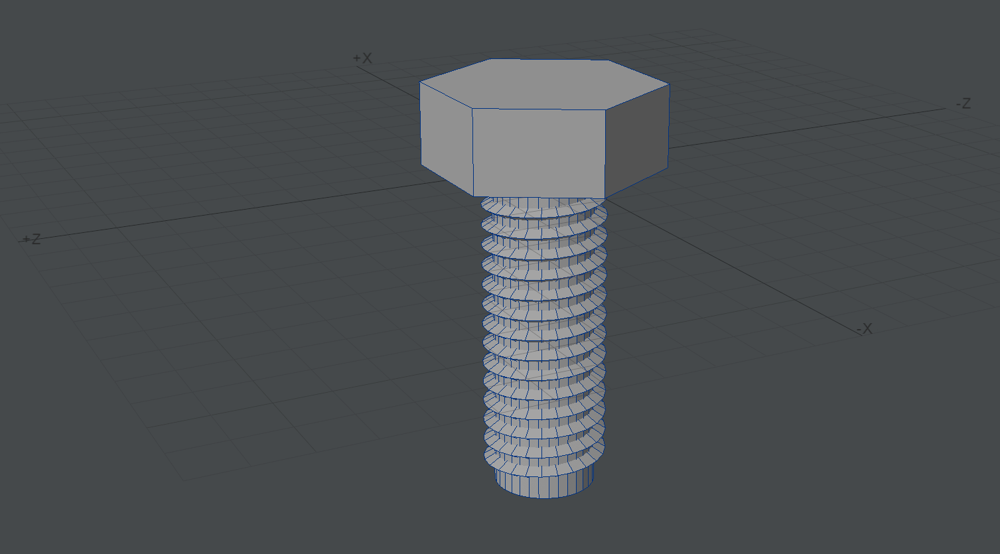

# Claude for LightWave

Let Claude work inside **LightWave 3D 2025** with you. Ask in plain words, and Claude builds
models in Modeler, sets up surfaces, lights, cameras and animation in Layout, and renders
frames to check its work, while you watch it happen in LightWave.

*"Create an M6 thread bolt with a 16 mm length." Claude modelled the hex head, the shank and a
1 mm pitch thread at real size in Modeler.*

*"Make the sphere aluminium and render it under a SkyTracer sky." Claude set the Principled
BSDF surface, added the sky and rendered in Layout.*

## What you need

- Windows with **LightWave 2025** (Layout; Modeler is optional)
- **Claude Desktop** ([download](https://claude.ai/download)) or Claude Code
- **Python 3.10 or newer**. If you don't have it, the installer offers to install it for you.

## Install

1. **Close LightWave** (Layout and Modeler).
2. Download the latest `claude-for-lightwave-<version>.zip` from the
   [Releases](../../releases) page and unzip it anywhere.
3. Double-click **Install LightWave MCP.cmd**.
   If Windows SmartScreen says it protected your PC, click **More info** > **Run anyway**.
4. Answer its questions. It:
   - copies the LightWave plugins and the Claude connector to `%LOCALAPPDATA%\LightWaveMCP`
   - makes the Layout plugin start with Layout
   - adds the Modeler plugin to Modeler's **Utilities > Additional** menu
   - offers to set Modeler's Alert Level to Expert, so a rejected command shows in the
     status bar instead of an error box that would pause Claude
   - connects Claude Desktop and Claude Code to LightWave

   Every LightWave or Claude settings file it changes is backed up first, next to the
   original, as `*.before-claude-for-lightwave`.
5. **Restart Claude Desktop.**

## Use

1. Start **LightWave Layout**. Claude can now reach it.
2. For **Modeler**, once each time you start Modeler: **Utilities > Additional >
   LW Bridge for Modeler (MCP)**.
3. In Claude, ask for what you want, for example:
   - *"Check the LightWave connection."*
   - *"Load my scene C:\Projects\robot.lws and render frame 1."*
   - *"Add a spotlight above the robot, aim it at its head and make it warm white."*
   - *"Animate the camera orbiting the robot over 120 frames, then show me frames 0, 30, 60 and 90."*
   - *"In Modeler, make a 1000-point sphere with evenly spread points, joined by triangles."*
   - *"Give the sphere a brushed aluminium surface with smoothing on."*

Claude sees what it does by rendering frames, and you see it live in LightWave.

### Good to know

- **Save your work.** Claude works on the scene you have open, and loading or clearing a
  scene discards unsaved changes. Save first, or ask Claude to save.
- **Panels pause Claude.** If a LightWave panel or file dialog is open, Claude waits until
  it's closed.
- Renders Claude makes for itself go to a temporary folder; your scene's own render
  settings and output paths are left alone.

## What Claude can do

- **Scenes:** load, save, clear; frame range, frame rate and resolution
- **Items:** add nulls, lights and cameras; rename, clone, delete, parent, target, aim
- **Animation:** set and delete keyframes on any channel, with curve shapes (TCB, linear,
  stepped, Bézier); animate light intensity and colour, camera zoom and focus
- **Lights and cameras:** intensity, colour, range, spot cone; zoom, focal length, field of
  view, depth of field; render sampling (less grain)
- **Surfaces:** classic surface values and node materials such as Principled BSDF and
  Skin, in Layout and Modeler, including smoothing
- **Modeler:** run any Modeler command, add points, make polygons in order (as when you
  click points and press Make Polygon), build whole meshes at once, save objects
- **Plugins:** list installed plugins and add one, such as a SkyTracer sky
- **Rendering:** render one frame or a short run of frames and look at them
- **Anything else:** run any Layout or Modeler command, with a built-in command reference

## Update or remove

- **Update:** download the new release, close LightWave, and run its installer.
- **Remove:** close LightWave and double-click **Uninstall LightWave MCP.cmd**. It removes
  the plugins, the Claude connections and the install folder.

## Privacy and safety

Everything runs on your computer. The LightWave plugins only accept connections from your
own machine, and each connection must carry a secret token that the plugin creates when
LightWave starts. Claude only does what you ask it to in your conversation.
